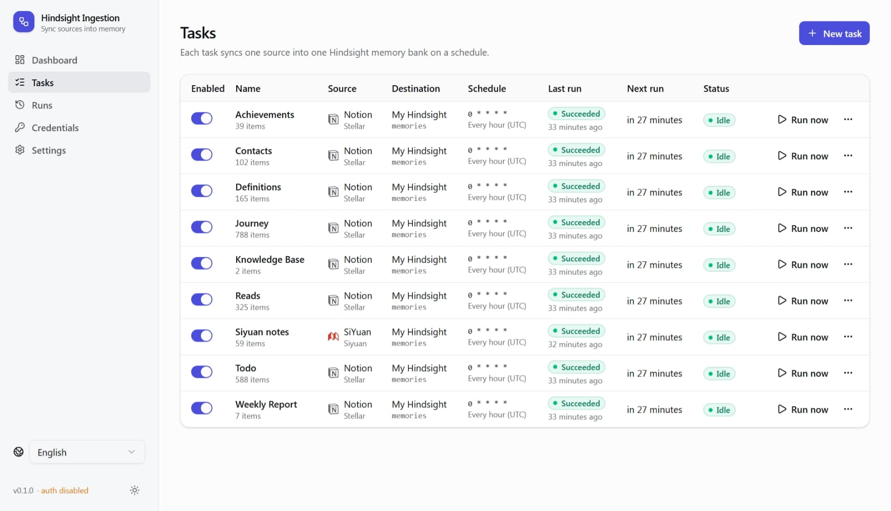

<div align="center">
  <h1>🧠 Hindsight Ingestion</h1>
  <p>Keep your notes and files in sync with Hindsight, automatically.</p>
</div>

<p align="center">
 
   
</p>

Sync **Notion, SiYuan, DeepWiki, S3, WebDAV, WebCAL, CalDAV, Email (IMAP), Steam, Google People, Google Drive, OneDrive and local files** into [Hindsight](https://github.com/vectorize-io/hindsight) memory banks. Self-host with Docker and manage everything from the WebUI.

<p align="center">
  <a href="#-features">Features</a> · <a href="#-supported-sources">Sources</a> · <a href="#-quick-start">Quick start</a> · <a href="#-usage">Usage</a> · <a href="#-configuration">Configuration</a> · <a href="#-development">Development</a>
</p>

<p align="center">
  
</p>

## ✨ Features

- ⚡ **Smart incremental sync** — Native change feeds, sync tokens and revision tracking detect what changed. Upload new or updated content and skip the rest.
- 🌐 **Multiple sources, one memory hub** — Bring Notion, SiYuan, S3, WebDAV, Google Drive, OneDrive and local files into Hindsight. Route each task to the bank you choose.
- 🖼️ **Multimodal ingestion** — Sync text, documents and multimodal files from S3, WebDAV, Google Drive, OneDrive and local storage into Hindsight.
- 🔄 **Stay in sync, deletions included** — Clean up documents when source items disappear or leave your sync scope. Incomplete scans never treat missing items as deletions.
- 🚀 **Streaming file ingestion** — Stream files directly into Hindsight without loading entire uploads into memory. Export Google Docs, Sheets and Slides as Markdown, CSV and PDF.
- 🎛️ **Your sync, your rules** — Combine filters, file types, retain strategies, tags and metadata. Set a schedule for every task, or run on demand.
- 🛡️ **Built to recover** — Persisted checkpoints and operation retries recover from failures and restarts. Overlap protection keeps each task from running twice at once.
- 🧪 **Preview and trace every change** — Dry-run shows planned changes before ingestion. Follow real runs through sync counters, Hindsight operations and detailed logs.
- 🔐 **Self-hosted, secrets encrypted** — Deploy with Docker, encrypt credentials with AES-256-GCM, and choose SQLite, PostgreSQL or MySQL for persistent storage.
- 🌍 **Localized interface** — Built-in multi-language WebUI supporting 14 locales with automatic browser detection and seamless switching.
- 🪶 **Lightweight** — ~18 MB minimal musl-based Docker image, ~20 MB idle RAM usage.

## 🔌 Supported Sources

| Source | Text | Multimodal | Incremental Sync | Use Cases |
| :--- | :---: | :---: | :---: | :--- |
| **Notion** | ✅ | ✅ | ✅ | Databases or pages with optional subpages, PRDs, engineering wikis, meeting notes |
| **SiYuan** | ✅ | ✅ | ✅ | Personal notes, academic research, linked Zettelkasten, offline docs |
| **S3 / S3-compatible storage** | ✅ | ✅ | ✅ | Enterprise document archives, data lakes, multimodal buckets, pipeline artifacts |
| **WebDAV** | ✅ | ✅ | ✅ | NAS storage (Synology/QNAP/Nextcloud), Obsidian & Zotero vaults |
| **WebCAL** | ✅ | — | ✅ | iCalendar events, todo tasks |
| **CalDAV** | ✅ | — | ✅ | Calendar collections, events and to-dos |
| **Steam** | ✅ | — | ✅ | Player profile, game library, playtime and achievements |
| **Email (IMAP)** | ✅ | — | ✅ | Email conversations, inbox indexing |
| **Google Drive** | ✅ | ✅ | ✅ | Google Workspace collaboration (Docs, Sheets, Slides), shared team drives |
| **Google People** | ✅ | — | ✅ | Saved contacts, people and organizations, relationships and contact notes |
| **OneDrive** | ✅ | ✅ | ✅ | Microsoft 365 workspaces, Office files (Word, Excel, PPT), SharePoint folders |
| **File System** | ✅ | ✅ | ✅ | Local source code repos, developer specs, local Obsidian/Logseq vaults |
| **SQL** | ✅ | — | ✅ | Data analysis, reporting from query results |
| **DeepWiki** | ✅ | — | — | Public repository documentation |
| **Cloudflare Browser Run (Web scraping)** | ✅ | — | ✅ | Online documentation, API references, blogs, public help centers & FAQs |

### Local files in Docker

Add a read-only directory mount to the service in [docker-compose.yml](docker-compose.yml):

```yaml
volumes:
  - hindsight-ingestion-data:/data
  - /path/on/host:/sources/documents:ro
```

## 🚀 Quick start

You need **Docker with Compose**, an existing **Hindsight instance**, and access to a source below.

### 1. Download and configure

Create a deployment folder and download the two configuration files:

```bash
mkdir hindsight-ingestion
cd hindsight-ingestion
curl -fLo docker-compose.yml https://raw.githubusercontent.com/Nyrest/hindsight-ingestion/main/docker-compose.yml
curl -fLo .env https://raw.githubusercontent.com/Nyrest/hindsight-ingestion/main/.env.example
```

Edit `.env` and fill in:

| Variable | What to enter |
| --- | --- |
| `BASIC_AUTH_PASSWORD` | WebUI login password. The username defaults to `admin`. |
| `CREDENTIAL_ENCRYPTION_KEY` | Generate with `openssl rand -hex 32`, or use a random passphrase of at least 16 characters. |

Keep the encryption key for restarts, upgrades and backups. Losing or changing it makes saved credentials unreadable.

### 2. Start the service

```bash
docker compose up -d
```

Open [http://localhost:8080](http://localhost:8080) and sign in with `admin` and the password you set.

### 3. Create your first task

1. In **Credentials**, add a **Hindsight** connection with its URL and optional API key, then a source connection if required. Use **Test** to check them. Google People, Google Drive and OneDrive also require OAuth setup and **Connect**.
2. In **Tasks**, choose the source, content to sync and destination bank. Leave the retain strategy empty to use the bank's default.
3. Choose a schedule in the application timezone. WebCAL, CalDAV, Email and Steam default to **Every hour**; a blank schedule runs manually. Save the task disabled if you want to preview first.
4. Use **Dry-run** to preview, then **Run now** to sync. Check **Runs** for results and enable the task for scheduled syncs.

## 📖 Usage

Task actions are available from the **Tasks** menu:

| Action | When to use it |
| --- | --- |
| **Run now** | Sync without waiting for the next scheduled run. |
| **Dry-run** | Preview changes without writing to Hindsight or changing sync progress. |
| **Full reconcile** | Scan the whole source to check for changes and deletions. Unchanged content is still skipped. |
| **Full re-ingest** | Upload every matching item again, including unchanged content. |
| **Cancel run** | Stop the current run. Changes already made in Hindsight are not rolled back. |
| **Delete documents** | Pause the task and delete its tagged Hindsight documents and associated memories, with live progress and an estimated remaining time. Source content stays intact; retry if cleanup fails. |
| **Disable** | Pause scheduled syncs while keeping the task's configuration and progress. |

## ⚙️ Configuration

Use `.env` for the bundled Compose deployment. Configure source credentials, tasks and global sync settings in the WebUI.

| Variable | Required | Default / purpose |
| --- | :---: | --- |
| `BASIC_AUTH_USERNAME` | ✅ | WebUI and API username. Compose default: `admin`. |
| `BASIC_AUTH_PASSWORD` | ✅ | WebUI and API password. |
| `CREDENTIAL_ENCRYPTION_KEY` | ✅ | Credential encryption key: 64 hex characters, base64-encoded 32 bytes, or a passphrase of at least 16 characters. |
| `PUBLIC_URL` | — | Empty by default; OAuth uses the current browser origin. Set to use a fixed external URL. |
| `LOG_LEVEL` | — | `info`. Also accepts `debug`, `warn` and `error`. |
| `TZ` | — | Unset. Optional container timezone override; also initializes the application timezone (UTC when unset). |
| `DISABLE_AUTH` | — | `false`. Set to `true` to allow access without signing in; DO THIS ONLY IF YOU HAVE EXTERNAL AUTHENTICATION SETUP LIKE CLOUDFLARE ACCESS. |

For these additional variables, edit the Compose service's `environment` section. Setting them only in `.env` does not override the bundled configuration.

| Variable | Default | Purpose |
| --- | --- | --- |
| `DB_TYPE` | `sqlite` | Database: `sqlite`, `postgres` or `mysql`. |
| `DB_DSN` | `/data/hindsight-ingestion.db` for SQLite | SQLite file path or database connection string. Required for PostgreSQL and MySQL. |
| `LISTEN_ADDR` | `:8080` | HTTP listen address. |

## 🛠️ Development

<details>
<summary>Build, run and check the project locally</summary>

Requires **Go 1.26.10+** (or **1.27.3+** on Go 1.27), a C compiler for SQLite, and **Bun 1.3+**. From the repository root, in Bash:

```bash
cd frontend
bun install --frozen-lockfile
bun run build
cd ../backend
export BASIC_AUTH_USERNAME=admin
export BASIC_AUTH_PASSWORD=dev
export CREDENTIAL_ENCRYPTION_KEY=$(openssl rand -hex 32)
export DB_DSN=./dev.db
go run ./cmd/server
```

Reuse the encryption key on subsequent starts. Run `bun run dev` in `frontend/` for the development UI; it proxies the API to port `8080`.

Before submitting a change, run `gofmt -l internal cmd`, `go build ./...`, `go vet ./...` and `go test ./...` from `backend/`, and `bun run build` from `frontend/`. Build the frontend first when producing a server that serves the WebUI.

After changing API routes or request/response types, regenerate the contract and frontend types:

```bash
cd backend
go generate ./internal/api
cd ../frontend
bun run generate:api
```

Backend tests detect a stale OpenAPI contract.

</details>

## 📜 License

[MIT](LICENSE).
